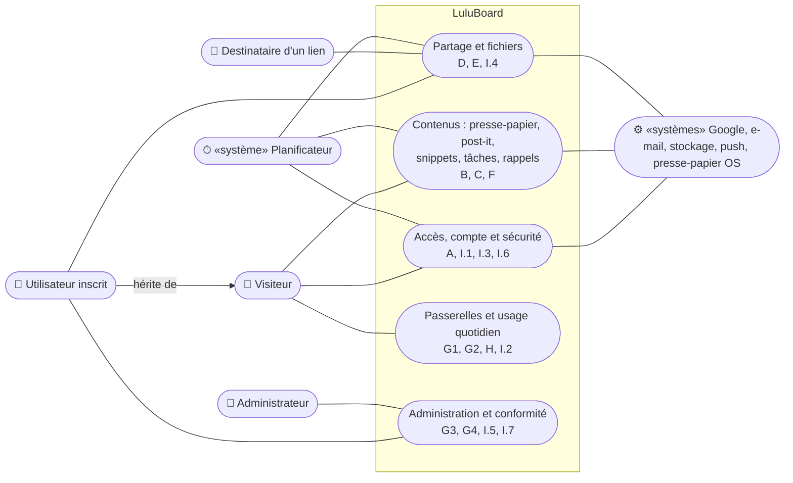
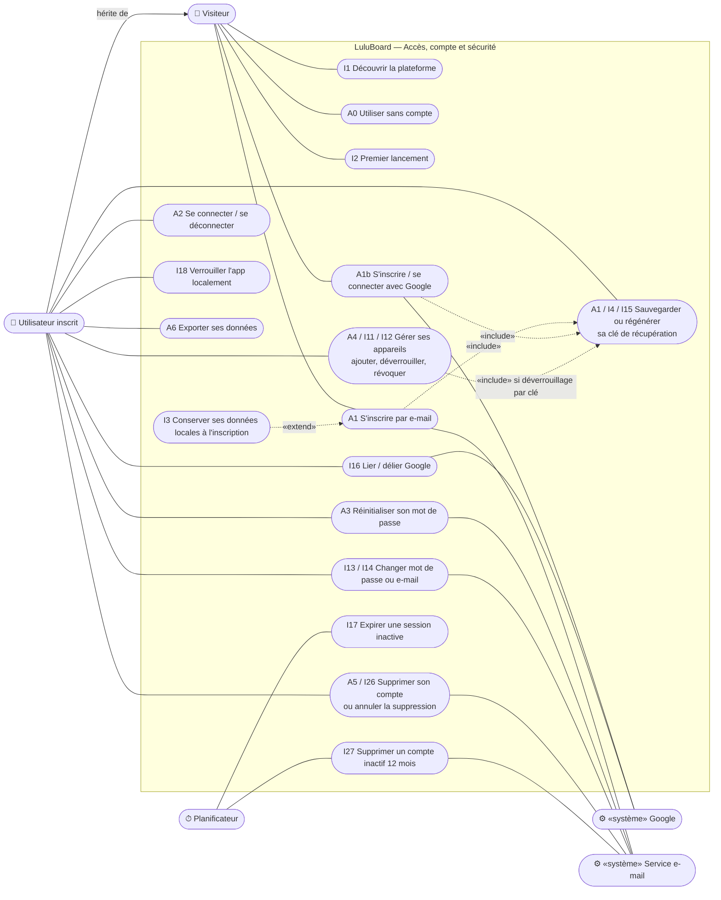
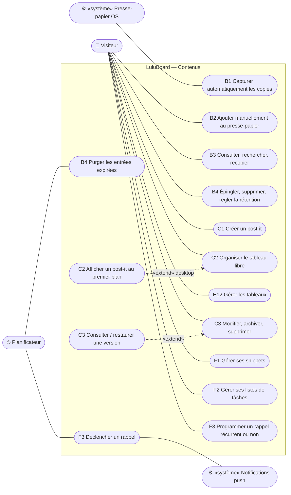
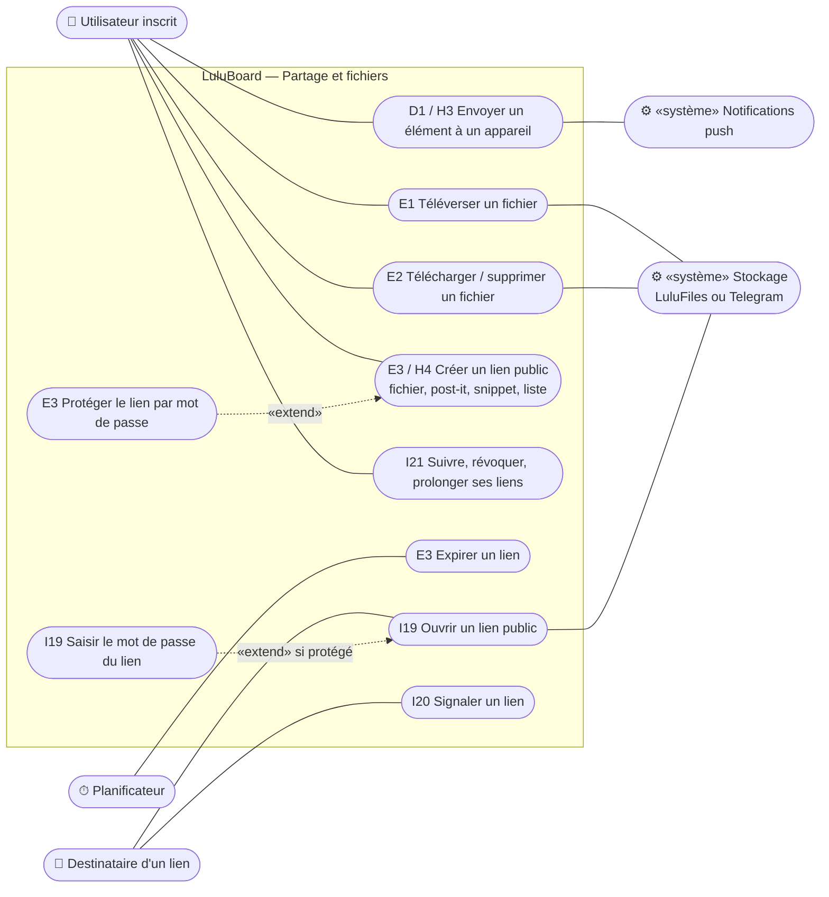
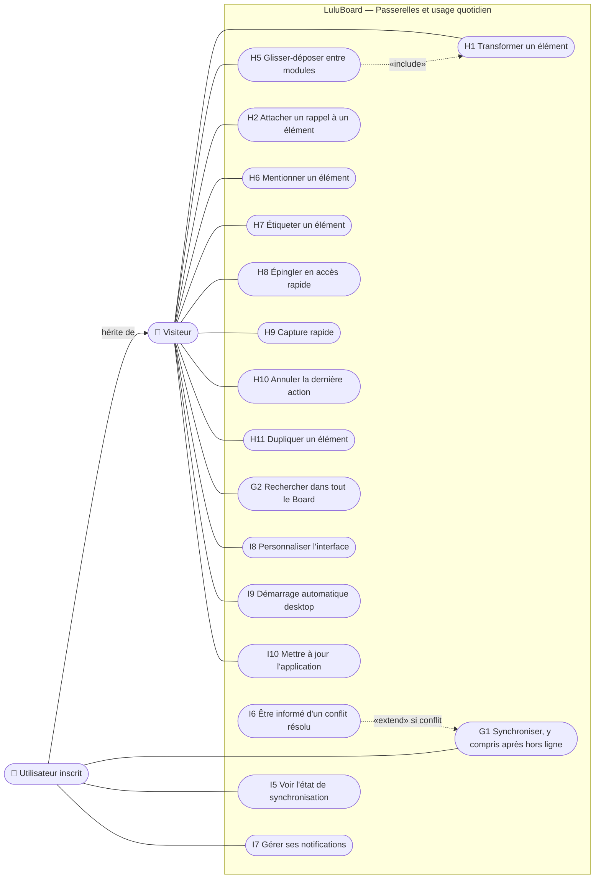
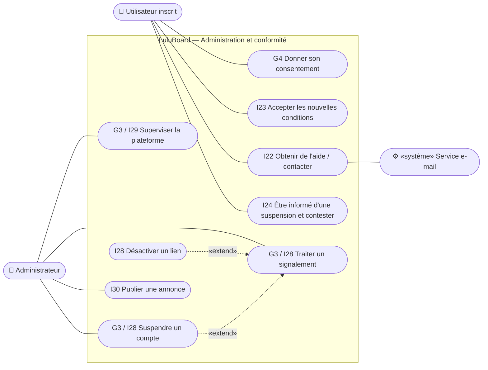

# LuluBoard — Diagramme de cas d'utilisation (VALIDÉ le 2026-10-08)

> Étape 2 de la méthode, première partie. Ce diagramme est dérivé strictement de `docs/01-cas-utilisation.md` (validé le 2026-10-08) : chaque ovale porte l'identifiant du cas d'origine.
> Pour rester lisible (15 à 20 nœuds maximum par diagramme), il est découpé en une vue d'ensemble et cinq sous-systèmes.

## Acteurs

| Acteur | Type | Source |
|---|---|---|
| Visiteur | humain | rôle défini dans les cas d'utilisation |
| Utilisateur inscrit | humain, **hérite** du Visiteur (il peut tout ce que peut le visiteur, plus le reste) | rôle défini dans les cas d'utilisation |
| Destinataire d'un lien | humain, sans compte | UC-I19, UC-I20 |
| Administrateur | humain | rôle défini dans les cas d'utilisation |
| Planificateur (temps) | «système», **déduit** | purges de rétention (UC-B4), déclenchement des rappels (UC-F3), comptes inactifs (UC-I27), expiration des liens (UC-E3) et des sessions (UC-I17) |
| Google | «système» externe | UC-A1b, UC-I16 |
| Service d'e-mail | «système» externe, **déduit** | codes de vérification (UC-A1, UC-A3, UC-I14), rappels (UC-I26, UC-I27) |
| Stockage de fichiers | «système» externe : LuluFiles **ou** Telegram direct | section E |
| Service de notifications push | «système» externe, **déduit** | UC-D1, UC-F3, UC-I7, UC-I11 |
| Presse-papier du système | «système» externe (OS desktop) | UC-B1 |

---

## Diagramme 0 — Vue d'ensemble

---

## Diagramme 1 — Accès, compte et sécurité

---

## Diagramme 2 — Contenus : presse-papier, post-it, snippets, tâches, rappels

Le Visiteur fait tout cela **localement** (UC-A0) ; l'Utilisateur inscrit en hérite, avec la synchronisation en plus.

---

## Diagramme 3 — Partage et fichiers

Réservé à l'Utilisateur inscrit (UC-A0 : fichiers et liens publics interdits aux visiteurs).

---

## Diagramme 4 — Passerelles et usage quotidien

---

## Diagramme 5 — Administration et conformité

---

## Points déduits à valider

1. **Quatre acteurs « système » sont déduits** et n'étaient pas nommés dans les cas d'utilisation : le Planificateur, le Service d'e-mail, le Service de notifications push et le Presse-papier du système.
2. **Héritage** : l'Utilisateur inscrit hérite du Visiteur. Il peut donc faire tout ce que fait le visiteur (en local), plus la synchronisation, les fichiers et le partage.
3. **Regroupements** : pour éviter les doublons, des cas proches sont regroupés dans un même ovale (par exemple A4, I11 et I12 forment « Gérer ses appareils »). Aucun cas n'a été retiré.
4. **Cas d'utilisation non représentés** : UC-I25, doublon de UC-A6 dans le document validé.
