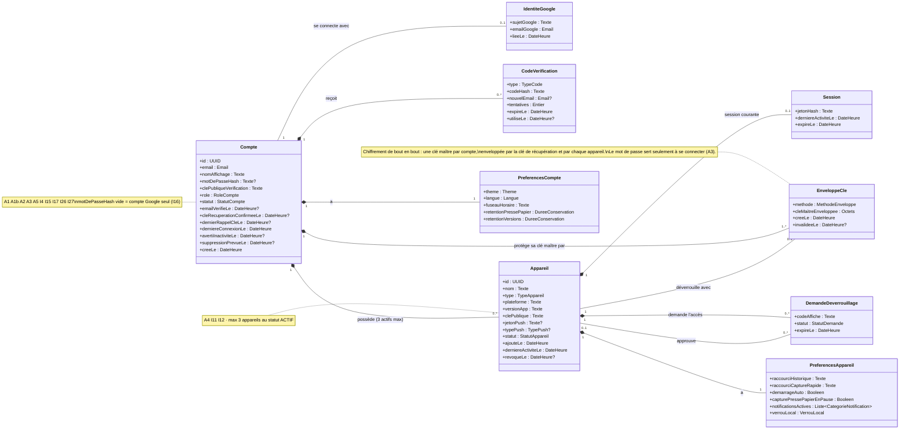
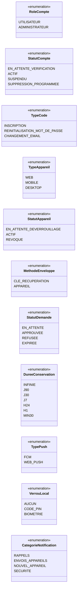
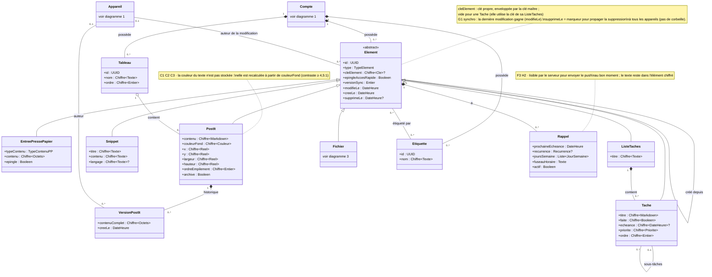
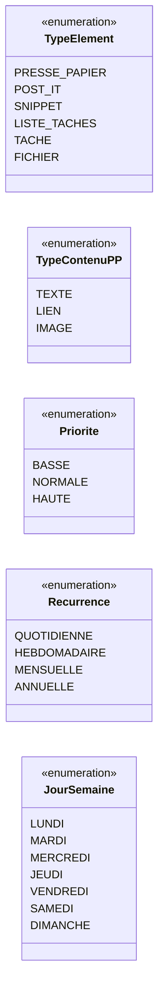
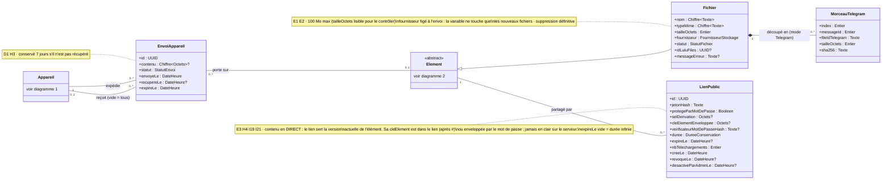
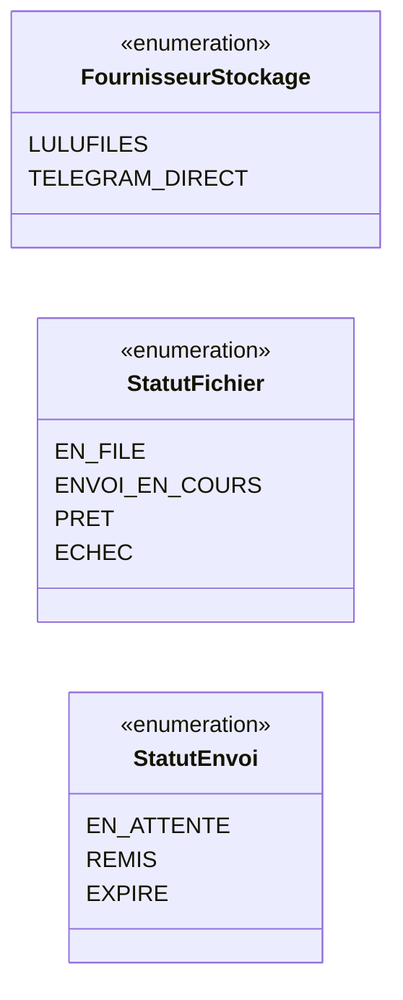
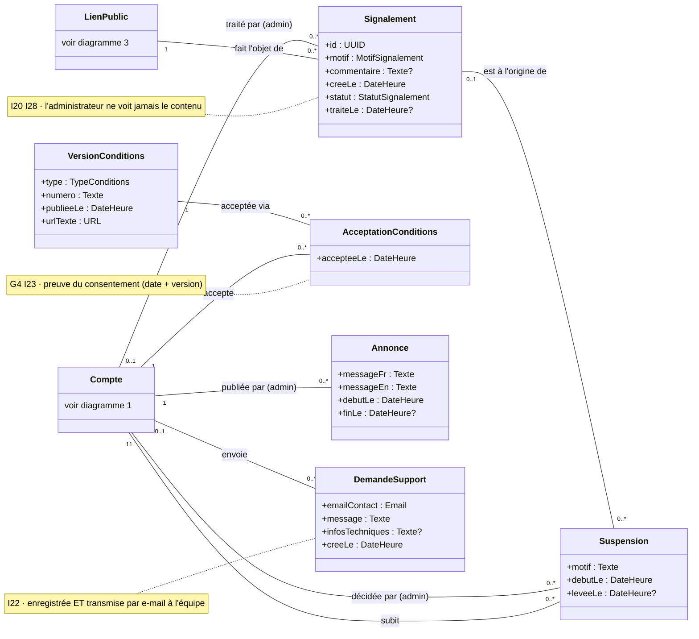
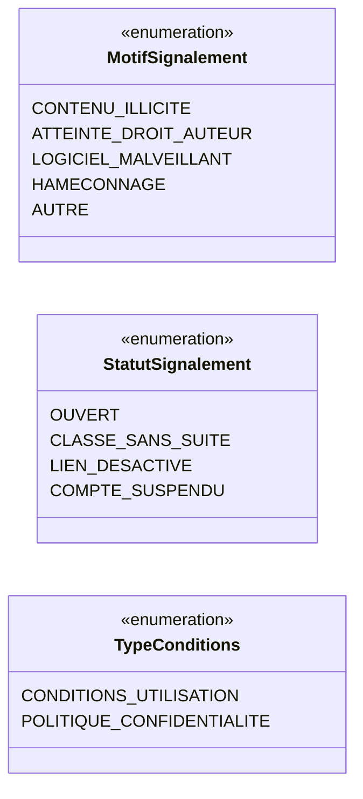

# LuluBoard — Diagramme de classes (VALIDÉ le 2026-10-08)

> Étape 2 de la méthode, seconde partie. Ce diagramme est dérivé de `docs/01-cas-utilisation.md` (validé) et de `docs/02-uml-cas-utilisation.md` (validé). C'est le **modèle de données métier** : il décrit ce qui est stocké, pas encore les tables SQL ni l'API (étape 3).

## Conventions de lecture

- `Chiffre~X~` : la donnée est **chiffrée de bout en bout**. Le serveur ne stocke qu'un contenu illisible ; seuls les appareils de l'utilisateur la voient en clair.
- Tout autre attribut est **lisible par le serveur**. C'est le strict nécessaire pour les comptes, la synchronisation, les limites (taille de fichier, 3 appareils), les rappels, l'expiration des liens et la modération.
- `Type?` : attribut facultatif (peut être vide).
- Chaque classe porte en note les cas d'utilisation qui la justifient.
- Les données d'un **Visiteur** ne quittent jamais son appareil (UC-A0). Ce modèle décrit donc le serveur et les comptes. L'app locale utilise les mêmes classes de contenu, sans `Compte`.

---

## Diagramme 1 — Compte, appareils et sécurité

### Énumérations du diagramme 1

---

## Diagramme 2 — Éléments du Board (contenus)

### Énumérations du diagramme 2

---

## Diagramme 3 — Fichiers, envois entre appareils et liens publics

### Énumérations du diagramme 3

---

## Diagramme 4 — Administration et conformité

### Énumérations du diagramme 4

---

## Ce qui n'est volontairement PAS dans le modèle

| Besoin | Pourquoi aucune classe |
|---|---|
| Export des données (A6) | généré sur l'appareil, rien n'est stocké |
| Mentions `[[…]]` (H6) | elles vivent dans le Markdown chiffré du post-it ou de la tâche |
| Annuler sous 10 s (H10) | délai géré par l'appareil avant l'envoi au serveur |
| Supervision (I29) | statistiques calculées à la volée |
| Blocage après 5 échecs (A2, I19) | compteurs techniques temporaires (cache), pas des données métier |
| Annonce fermée par l'utilisateur (I30) | mémorisée localement sur l'appareil |
| État de synchronisation (I5) | calculé par l'appareil |
| Post-it affiché au premier plan (C2) | réglage propre à chaque ordinateur, mémorisé localement ✅ |

## Ajouts du 2026-10-09 (imposés par le contrat d'API, validés ✅)

1. `Compte.clePubliqueVerification` : clé publique dérivée de la clé maître. Elle sert à prouver qu'un appareil déverrouillé par la clé de récupération possède bien la clé maître.
2. `Appareil.jetonPush` + `Appareil.typePush` (FCM ou WEB_PUSH) : nécessaires pour envoyer les notifications push.
3. `LienPublic.verificateurMotDePasseHash` : permet au serveur de bloquer après 5 essais faux (I19).
4. Les identifiants des éléments, tableaux, étiquettes et rappels sont **générés par le client** (UUID v7), pour permettre la création hors ligne.

## Décisions de modélisation

Déduites par moi, à valider :
1. **Administrateur = rôle sur le Compte** (`role`), et non une table séparée.
2. **Clé maître + enveloppes** (`EnveloppeCle`) : c'est le mécanisme qui réalise le chiffrement de bout en bout, la clé de récupération et le déverrouillage d'un appareil par un autre.
3. **Une clé par élément** (`cleElement`), enveloppée par la clé maître. C'est ce qui permet le lien public en direct : le lien ne donne accès qu'à cet élément, jamais au reste du compte. Les tâches utilisent la clé de leur liste, pour qu'un lien de liste montre aussi ses tâches et sous-tâches.
4. **Tout le contenu est chiffré, y compris les positions et les couleurs des post-it.** Seul ce que le serveur doit lire reste en clair : la taille des fichiers, les dates de rappel, l'expiration des liens.
5. **Pas de corbeille** : un élément supprimé reçoit seulement `supprimeLe`, pour que la suppression atteigne les autres appareils. Ses liens publics cessent alors de fonctionner.
6. **Limite du lien en direct** : révoquer un lien bloque l'accès par le serveur. En revanche, quelqu'un qui a déjà ouvert le lien a déjà vu le contenu de ce moment-là.

Tranchées par vous le 2026-10-08 ✅ :
- Le tableau ne contient **que des post-it**. Déposer un fichier sur le tableau (H5) crée un élément Fichier, rangé avec les fichiers, pas sur le tableau.
- Historique des versions : **post-it uniquement**.
- **Plusieurs rappels** par élément.
- Lien public : affiche les **modifications en direct**.
- Affichage au premier plan : **propre à chaque ordinateur**, mémorisé localement, donc absent du modèle serveur.
- Motifs de signalement : **validés**.
- Demande de support : **enregistrée en base et envoyée par e-mail**.
